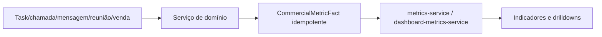
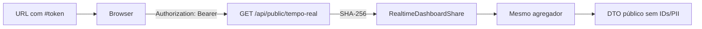
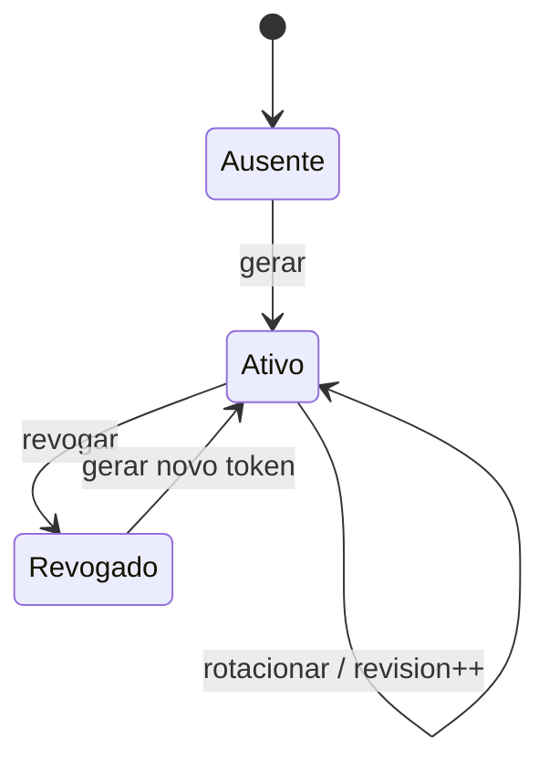

# 00 — Projeto, auditoria e baseline

## Objetivo e não objetivos

Entregar um placar comercial de TV com totais diários/semanais, ranking auditável, meta semanal e compartilhamento público revogável. Não cria novo log, data warehouse, websocket, gamificação, edição de metas, streaming ou tracking de produtividade.

## Baseline Git

- Branch: `main`, upstream `origin/main`.
- HEAD inicial: `df7dd55657b53b7d2f224ce0572924ebb3269828`.
- Working tree inicial: alterações alheias em `package.json`, `pnpm-lock.yaml`, `prisma/schema.prisma`, `src/components/layout/app-shell.tsx`, `src/proxy.ts`, autenticação, aquisição/marketing e arquivos novos de formulários.
- O prompt mestre local é idêntico a `docs/PROMPT_MASTER_TEMPO_REAL_CRM.md`.

## Matriz de evidências

| Capacidade | Estado | Evidência | Fonte de verdade/reuso | Gap/risco | Task |
|---|---|---|---|---|---|
| Shell e grupo Trabalho | PRESENTE | `src/components/layout/app-shell.tsx` | navegação por permission/role | arquivo já alterado por outra iniciativa | T2 |
| Rotas públicas sem shell | PRESENTE/PARCIAL | `app-shell-routes.ts`, `/f`, `src/proxy.ts` | helper exato + Proxy | novo namespace deve ser exato | T7 |
| Sessão/RBAC | PRESENTE | `authentication-guards.ts`, `authorization-service.ts` | auth server-side e scope | capabilities específicas ausentes | T2 |
| Fatos comerciais | PRESENTE | `CommercialMetricFact`, `metrics-service.ts` | ledger idempotente por `eventKey` | qualidade pode ser parcial | T1/T3 |
| Agregação por vendedor | PRESENTE/PARCIAL | `summarizeDashboardSellerActivity` | crédito por tipo de evento | DTO atual é amplo e contém IDs | T1 |
| Contato efetivo | PRESENTE | `effective-contact-metrics.ts` | leads distintos com saldo positivo | explicitar canais | T1 |
| Ligações | PRESENTE | `CALL_ATTEMPTED` | tentativa canônica; desfechos não somam outra ligação | nenhum | T1 |
| Mensagens | PRESENTE | `WHATSAPP_MESSAGE_SENT`, `INSTAGRAM_MESSAGE_SENT`, `EMAIL_SENT` | somente envio confirmado | SMS/inbox não têm fato canônico de envio | T1 |
| Reuniões | PRESENTE | `MEETING_SCHEDULED`, `MEETING_COMPLETED` | agenda/movimento de etapa com origem controlada | validar reversões | T1 |
| Vendas | PRESENTE | `SALE_WON` | quantidade e `valueCents` | nenhum | T1 |
| Meta semanal | PARCIAL | `GoalPlan`/`GoalQuota` | plano publicado e quota `OPPORTUNITIES_WON` | ausência legítima deve ser `null` | T3 |
| Timezone | PRESENTE | `workspace.timeZone`, `workspace-time.ts` | intervalos civis `[from,to)` | feriados não têm calendário canônico | T1 |
| Elegibilidade | PRESENTE | `commercialMemberWhere` | funções SDR/CLOSER ativas + histórico | avatar não existe no schema | T3/T5 |
| Rate limit distribuído | PRESENTE | `request-hardening.ts`, `RequestRateLimit` | PostgreSQL em staging/prod | definir política do placar | T7 |
| Auditoria | PRESENTE | `AuditLog` | append-only para rotate/revoke | não auditar cada leitura pública | T6 |
| Headers/CSP | PRESENTE | `security-headers.ts`, `next.config.ts`, `proxy.ts` | headers globais e nonce | `no-referrer`/`noindex` específicos | T7 |
| Fullscreen/timers | AUSENTE | busca por `requestFullscreen` | Web API + React | cleanup/aba oculta/reduced motion | T5/T8 |
| Deploy | PRESENTE | `SUPABASE_VERCEL_DEPLOYMENT.md`, CI, `vercel.json` | migrations explícitas antes do deploy | revalidar conta/projeto e backup | T11 |

## Fluxos observados



```mermaid
flowchart LR
  S[Sessão] --> G[requireApiAuthentication]
  G --> R[AuthorizationService: metrics.read]
  R --> M[MetricsService]
  M --> F[CommercialMetricFact]
  M --> UI[/dashboard]
```

## Fluxos propostos

```mermaid
flowchart LR
  U[Admin/Gestor] --> P[/tempo-real]
  P --> A[GET /api/tempo-real]
  A --> Z[realtime-dashboard-service]
  Z --> F[CommercialMetricFact]
  Z --> Q[GoalPlan/GoalQuota]
  Z --> D[DTO mínimo]
```





## Usuários e permissões

- `realtime.read` em escopo `WORKSPACE`: administrador e gestor comercial.
- `realtime.share.manage` em escopo `WORKSPACE`: administrador e gestor comercial.
- Vendedor sem capability não recebe o menu nem acesso direto autenticado.
- O bearer público não equivale a sessão, capability ou acesso a outra API.

## Riscos

- Link pode ser fotografado/encaminhado: risco residual explícito até revogação.
- Polling multiplicado por TVs: rate limit e consulta indexada obrigatórios.
- Qualidade histórica parcial: expor estado e motivo, nunca mascarar como “ao vivo”.
- Working tree concorrente: staging seletivo e inspeção do diff antes de commit/deploy.
